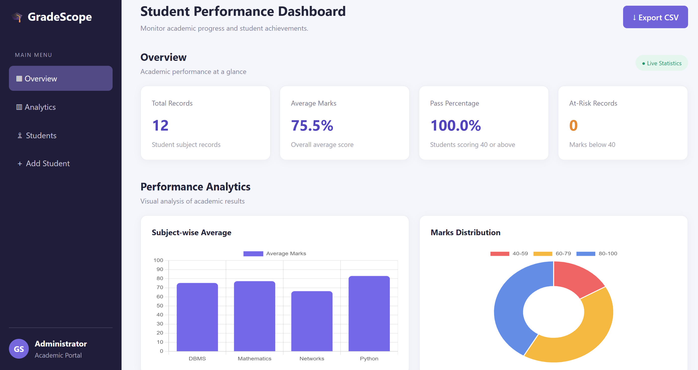

# GradeScope – Student Performance Analytics

GradeScope is a web-based Student Performance Analytics System developed using Python, Flask, SQLite, HTML, CSS and JavaScript.

## Features

- Interactive academic dashboard
- Student record management
- Add and delete student records
- Subject-wise performance analysis
- Department-wise comparison
- Student marks distribution charts
- Top-performing student identification
- At-risk student identification
- CSV report export
- SQLite database integration

## Technologies Used

- Python
- Flask
- SQLite
- HTML5
- CSS3
- JavaScript
- Chart.js

## Installation

1. Clone the repository.
2. Create a virtual environment:

   python -m venv venv

3. Activate it on Windows:

   venv\Scripts\activate

4. Install dependencies:

   pip install -r requirements.txt

5. Run the application:

   python app.py

6. Open http://127.0.0.1:5000 in your browser.

## Project Structure

GradeScope_New/
- app.py
- requirements.txt
- README.md
- .gitignore
- templates/
  - index.html
- static/
  - style.css

## Developed For

College-level academic project.

## Dashboard Preview

